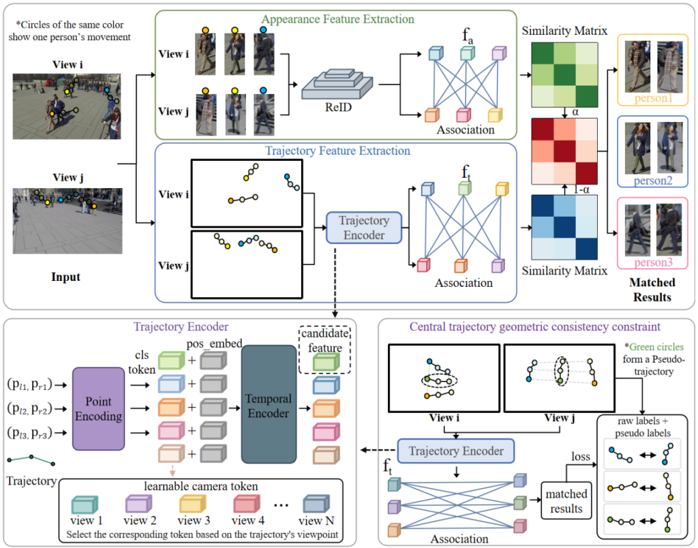

## **A Calibration-Free Multi-View Person Association Approach via Implicit Trajectory Geometry Modeling**

### Overall framework


#### In this repo we provide:
- Training and testing code. 
- Trained models on the WILDTRACK / MultiviewX / MVOR datasets. 

## Installation
1. Clone this repo, and we'll call the directory that you cloned as ${ROOT_DIR}.
2. Install dependencies. 
```shell
> conda create -n mva python=3.9
> conda activate mva
(mva)> pip install torch==2.5.0+cu118 torchaudio==2.5.0+cu118 torchvision==0.20.0+cu118
(mva)> pip install -r requirements.txt
```
3. Install Torchreid following [deep-person-reid](https://github.com/KaiyangZhou/deep-person-reid)

    Alternatively, download the torchreid folder and place it directly under the core folder as follows:
```
${ROOT_DIR}
|-- core
    |-- ...
    |-- torchreid
```

## Data preparation

### WILDTRACK dataset
Download the [WILDTRACK dataset](https://www.epfl.ch/labs/cvlab/data/data-wildtrack/) and place it in `./data/`, organized as follows:
```
${ROOT_DIR}
|-- data
    |-- Wildtrack
        |-- frames
            |-- 0_0.jpg
            |-- 0_1.jpg
            |-- 0_2.jpg
            |-- 0_3.jpg
            ...
        |-- gt_train_3len.json
        |-- gt_eval_3len.json
        |-- gt_test_3len.json
```
The frames folder contains the images for each frame and each view. For example, 0_1.jpg denotes frame 0, view 1; 1_3 denotes frame 1, view 3, and so on. gt_train_3len.json / gt_eval_3len.json / gt_test_3len.json represent the ground-truth annotations for training / validation / testing respectively (3len indicates a trajectory length of 3), in a format like:
```
{"0": [[-1,-1,-1,-1,-1,-1,-1,-1,1510,139,51,160,122,0], [-1,-1,-1,-1,-1,-1,-1,-1,813,10,78,279,122,1]...],
"1": [[-1,-1,-1,-1,1120,164,61,215,1066,169,64,226,4,0],[-1,-1,-1,-1,1439,0,56,188,1478,0,54,179,4,1]...],
...
}
```
- The key denotes the current frame, and each element is[x1,y1,w1,h1,x2,y2,w2,h2,x3,y3,w3,h3,tid,cid]
- The first 12 values consist of the top-left coordinates (x, y), width w, and height h of the pedestrian's bounding boxes over 3 consecutive frames, representing the pedestrian's motion trajectory. The first two boxes represent the two historical frames, and the third box represents the current frame. For non-existent boxes, -1 is used as padding. For example, when the key is "0", the first two boxes do not exist, so they are replaced with -1.
- tid denotes the pedestrian ID (each pedestrian has a unique ID).
- cid denotes the view in which the trajectory is located.
- If you need to change the length of the trajectory segment, simply reorganize the annotation file in the manner described above, and rename "3len" in the new annotation file name to "(new length)len".

### MultiviewX dataset
Download the [MultiviewX dataset](https://github.com/hou-yz/MultiviewX), and place them in `./data/`, organized as follows:
```
${ROOT_DIR}
|-- data
    |-- MultiviewX
        |-- frames
            |-- 0_0.jpg
            |-- 0_1.jpg
            |-- 0_2.jpg
            |-- 0_3.jpg
            ...
        |-- gt_train_3len.json
        |-- gt_eval_3len.json
        |-- gt_test_3len.json
```

### MVOR dataset
Download the [MVOR dataset](https://github.com/CAMMA-public/MVOR), and place them in `./data/`, organized as follows:
```
${ROOT_DIR}
|-- data
    |-- MVOR
        |-- frames
            |-- 0_0.jpg
            |-- 0_1.jpg
            |-- 0_2.jpg
            |-- 1_0.jpg
            ...
        |-- gt_train_1len.json
        |-- gt_eval_1len.json
        |-- gt_test_1len.json
```


### Models
1. Download the pre-trained reid models as follows. 
```shell
> wget https://huggingface.co/JiawangYang/mva/resolve/main/osnet_ain_ms_d_c.pth.tar?download=true
```

2. Download the trained models on three datasets. 

|   Model      |  Model Weights |
| :----------: | :-----:   |
| [WILDTRACK](configs/wildtrack.yaml)| [download](https://huggingface.co/JiawangYang/mva/resolve/main/wildtrack_best_model.pth.tar?download=true) |
| [MultiviewX](configs/multiviewX.yaml)| [download](https://huggingface.co/JiawangYang/mva/resolve/main/multiviewX_best_model.pth.tar?download=true) |
| [MVOR](configs/mvor.yaml)| [download](https://huggingface.co/JiawangYang/mva/resolve/main/mvor_best_model.pth.tar?download=true) |

The directory tree should look like this:
```
${ROOT_DIR}
|-- weights
|   |-- osnet_ain_ms_d_c.pth.tar
|   |-- wildtrack_best_model.pth.tar
|   |-- multiviewX_best_model.pth.tar
|   |-- mvor_best_model.pth.tar
```

## Training
Before formal training, you need to modify the configuration files under configs. Each dataset corresponds to one yaml file. For example, the content of configs/wildtrack.yaml is:
```
IMG_SIZE: 
  - 224
  - 224
DATASET: 'wildtrack'
VIEW_IDS: [0,1,2,3,4,5,6]
PROMPT_MODE: 'box'
TRAJECTORY_LEN: 3
CKP: 'model_best_train_loss.pth.tar'
DEPTH: 2

TRAIN:
  BATCH_SIZE: 1
  EPOCH: 1200
  RESUME: False
  LR: 0.0001
  LR_FACTOR: 0.1
  LR_STEP: [900]
  EDGE_ASSOCIATION: False
  EDGE_LOSS_WEIGHT: 0.1
TEST:
  THRESH: 0.45

REID: True
ALPHA: 0.1

EXP_DIR: './results/exp'
```
- IMG_SIZE: the size to which images are resized
- DATASET: the dataset
- VIEW_IDS: the list of views contained in the current dataset
- PROMPT_MODE: the representation of pedestrian positions in each frame (default is box)
- TRAJECTORY_LEN: the length of the trajectory segment
- CKP: the model file
- DEPTH: the network depth of the trajectory encoder
- TRAIN:
    - BATCH_SIZE: batch size
    - EPOCH: number of training epochs
    - RESUME: whether to resume training from the last interruption
    - LR: learning rate
    - LR_FACTOR: learning rate decay factor
    - LR_STEP: the epoch at which to decay the learning rate
    - EDGE_ASSOCIATION: whether to use the central trajectory geometric consistency constraint during training
    - EDGE_LOSS_WEIGHT: the weight of the central trajectory geometric consistency constraint
- TEST:
    - THRESH: the score threshold set when evaluating the model
- REID: whether to use the re-identification model
- ALPHA: the weight of the appearance feature
- EXP_DIR: the path where the final results are saved

### WILDTRACK dataset
```
python core/main.py --cfg configs/wildtrack.yaml
```

### MultiviewX dataset
```
python core/main.py --cfg configs/multiviewX.yaml
```

### MVOR dataset
```
python core/main.py --cfg configs/mvor.yaml
```

## Evaluation
### WILDTRACK dataset
```
python core/main.py --cfg configs/wildtrack.yaml --test
```

### MultiviewX dataset
```
python core/main.py --cfg configs/multiviewX.yaml --test
```

### MVOR dataset
```
python core/main.py --cfg configs/mvor.yaml --test
```

## Tips for custom dataset
If you need to build a custom dataset, after organizing it in the manner described above, you also need to further modify the dataset.py file:
```
if self.dataset == 'wildtrack':
    self.dataset_dir = 'data/Wildtrack'
elif self.dataset == 'mvor':
    self.dataset_dir = 'data/Mvor'
elif self.dataset == 'multiviewX':
    self.dataset_dir = 'data/MultiviewX'
    self.suffix = '.png'
```
For example, if the newly added dataset is new_dataset, add the following after the above code:
```
elif self.dateset == 'new_dataset':
    self.dataset_dir = 'data/new_dataset'
```
And create a new yaml configuration file configs/new_dataset.yaml for it. The training and evaluation commands are the same as described above.

### References
The project uses [Self-mva](https://github.com/CAMMA-public/Self-MVA). We thank the authors for releasing their codes. 
